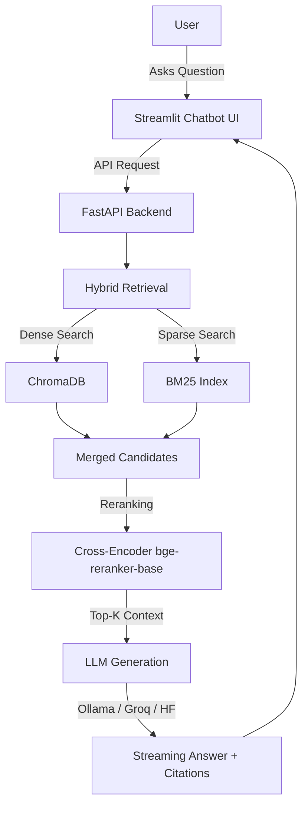

# Loan Eligibility Assistant

A local AI-powered banking loan eligibility assistant built with FastAPI, Streamlit, ChromaDB, LangChain, Ollama, Docker, and Langfuse.

The application answers questions about loan eligibility rules using Retrieval-Augmented Generation (RAG) over local policy PDFs. It keeps source citations with answers, supports a chatbot-style Streamlit interface, and can run locally or with both frontend and backend in Docker. The LLM model stays outside Docker and is served by Ollama on the host machine.

## Business Problem

Loan pre-qualification takes staff time and can produce inconsistent answers. This assistant provides a consistent, document-grounded way to answer common loan eligibility questions about income, credit score, age, documents, debt-to-income ratio, tenure, and applicant type.

## Current Features

- **FastAPI backend** with `/ask`, `/ask/stream`, `/health`, and `/` endpoints
- **Streamlit chatbot frontend** with streaming answers and session conversation history
- **Advanced Hybrid RAG**:
  - **Sentence-aware Chunking**: Uses NLTK `sent_tokenize` to ensure legal clauses are not cut mid-sentence, carrying over overlapping sentences for context.
  - **Hybrid Retrieval**: Combines Dense Retrieval (ChromaDB) and Sparse Retrieval (Custom BM25 algorithm) for maximum coverage.
  - **Neural Reranking**: Uses `CrossEncoder('BAAI/bge-reranker-base')` to rerank and select the top 5 most semantically relevant chunks.
- **Local Execution**: Uses Ollama for local chat models and embeddings.
- **Source Citations**: Answers include exact excerpts, page numbers, and clause identifiers.
- **Explicit Provider Selection**: The UI can send a request to local Ollama, Groq, or Hugging Face. The app does not silently switch providers.
- **Observability & Logging**: Langfuse tracing wrapper and local audit logs in JSONL format.
- **Docker Support**: Containerized FastAPI backend and Streamlit frontend.

## Architecture Flow



## Tech Stack

| Layer | Tool | Purpose |
|---|---|---|
| Frontend | Streamlit | Local chatbot UI |
| Backend | FastAPI | API layer for chat requests |
| RAG Framework | LangChain | PDF loading, chunking, retrieval, and LLM calls |
| Chunking | NLTK | Sentence-aware tokenization to preserve legal clauses |
| Vector Store | ChromaDB | Local semantic search (Dense retrieval) |
| Sparse Search | BM25 | Custom keyword-based exact match retrieval |
| Reranking | Sentence-Transformers | Cross-Encoder for semantic query-document scoring |
| LLM Runtime | Ollama | Local open-source model execution |
| Embeddings | Ollama embeddings | Local vector embeddings for retrieval |
| Tracing | Langfuse | Observability around API/RAG calls |
| Audit Logs | JSONL file | Local request metadata logging |
| Containerization | Docker | Portable backend & frontend runtime |

## Project Structure

- `app/`: FastAPI application code
  - `main.py`: API routing and application entrypoint
  - `rag.py`: Core RAG logic (Chunking, BM25, Reranker, LLM calls)
  - `config.py`: Environment configurations
  - `tracing.py`, `audit.py`: Langfuse integration and local audit logging
- `data/`: Source PDFs for vectorstore ingestion (e.g. `MBBL_Business_Loan_Agreement_New.pdf`, `Businees-Loan-for-Entitiy(Unsecured)-Agreement.pdf`)
- `frontend/`: Streamlit UI (`streamlit_app.py`)
- `vectorstore/`: Local persistent storage for ChromaDB and document caches
- `logs/`: Application audit logs (`audit.jsonl`)
- Config files: `Dockerfile`, `Dockerfile.frontend`, `docker-compose.yml`, `requirements.txt`, etc.

## Prerequisites

- Python 3.11
- Git
- Ollama
- Docker Desktop (optional, for containerized run)

## Ollama Setup

1. Start Ollama: `ollama serve`
2. Pull chat model: `ollama pull qwen3.5:2b`
3. Pull embedding model: `ollama pull nomic-embed-text`
4. Test: `ollama run qwen3.5:2b "Reply only: ready"`

## Environment Variables

Create a `.env` file in the project root:

```env
CHAT_MODEL=qwen3.5:2b
EMBEDDING_MODEL=nomic-embed-text:latest
OLLAMA_BASE_URL=http://localhost:11434
OLLAMA_WARMUP_TIMEOUT=20

GROQ_API_KEY=
GROQ_MODEL=openai/gpt-oss-20b
HF_API_KEY=
HF_MODEL=mistralai/Mistral-7B-Instruct-v0.3
```

Hosted provider keys are optional. If the user selects Groq or Hugging Face in the UI and the key is missing or invalid, the app shows a clear provider error. It does not automatically fall back to another provider.

## Run Locally

1. Create and activate a virtual environment:
   ```powershell
   python -m venv capstone
   .\capstone\Scripts\activate
   ```
2. Install dependencies:
   ```powershell
   pip install -r requirements.txt
   ```
3. Start backend:
   ```powershell
   uvicorn app.main:app --reload
   ```
4. Start frontend:
   ```powershell
   streamlit run frontend/streamlit_app.py
   ```

## Run With Docker Compose

For the capstone demo, the recommended mode is **local Python + host Ollama** because it is fastest to debug and keeps the local model available directly. Docker Compose is still supported for showing deployment readiness: frontend and backend run in containers, while Ollama remains on the host.

```powershell
# Start Ollama on the host machine first
ollama serve

# Build and start the app
docker compose up --build
```

> [!NOTE]
> The backend image includes the dependencies needed for NLTK sentence chunking and the `BAAI/bge-reranker-base` CrossEncoder reranker. The reranker model and NLTK tokenizer data may download on first startup, so the first run can be slower than later runs.

## Rebuilding The Vector Store

The app persists ChromaDB data and a document cache in `vectorstore/`.

For a normal restart, do nothing. The app reuses the existing vector store and skips re-ingestion.

For a controlled rebuild after changing PDFs or chunking logic:

```powershell
$env:FORCE_REBUILD_VECTORSTORE="true"
uvicorn app.main:app --reload
```

For Docker, set `FORCE_REBUILD_VECTORSTORE: "true"` temporarily in the backend environment in `docker-compose.yml`, run the app once, then set it back to `"false"`. Docker does not show the local interactive rebuild prompt, so this environment variable is the correct rebuild control for containers.

## Model And Provider Selection

Update `CHAT_MODEL` in `.env` to switch the local Ollama model. The Streamlit UI also exposes provider selection for each request:

- `local`: uses Ollama on the host machine
- `groq`: uses the configured Groq API key/model
- `huggingface`: uses the configured Hugging Face API key/model

The selected provider is the provider used for that request. There is no hidden provider fallback.

## Command Reference

This section is for anyone cloning the repository. Run these commands from the project root, not from a machine-specific path.

### Clone And Enter The Project

```powershell
git clone https://github.com/<username>/<repository>.git
cd <repository>
```

### Local Setup

```powershell
python -m venv capstone
.\capstone\Scripts\activate
pip install -r requirements.txt
copy .env.example .env
```

After copying `.env.example`, update `.env` with local values and optional API keys.

### Ollama Setup

Run this in a separate terminal:

```powershell
ollama serve
```

In another terminal, pull and test the models:

```powershell
ollama list
ollama pull qwen3.5:2b
ollama pull nomic-embed-text
ollama run qwen3.5:2b "Reply only: ready"
```

### Start Backend Locally

```powershell
.\capstone\Scripts\activate
uvicorn app.main:app --reload
```

Backend URLs:

```text
http://localhost:8000/
http://localhost:8000/health
http://localhost:8000/docs
```

### Start Frontend Locally

Run this in a second terminal:

```powershell
.\capstone\Scripts\activate
streamlit run frontend/streamlit_app.py
```

Frontend URL:

```text
http://localhost:8501
```

### Test Backend Manually

```powershell
Invoke-RestMethod -Uri "http://localhost:8000/health"
```

```powershell
Invoke-RestMethod -Uri "http://localhost:8000/ask" -Method Post -ContentType "application/json" -Body '{"question":"What is foreclosure?","history":[],"session_id":"manual-test","model_provider":"local"}'
```

### Docker Commands

Ollama still runs outside Docker, so start it first:

```powershell
ollama serve
```

Build and start both containers:

```powershell
docker compose up --build
```

Start both containers in the background:

```powershell
docker compose up --build -d
```

Open the app:

```text
http://localhost:8501
```

Check backend health:

```text
http://localhost:8000/health
```

View containers:

```powershell
docker ps
```

View logs:

```powershell
docker compose logs -f backend
docker compose logs -f frontend
```

Stop containers:

```powershell
docker compose down
```

Stop containers and delete Docker volumes, including the persisted vectorstore:

```powershell
docker compose down -v
```

### Rebuild Vectorstore

Local one-time rebuild:

```powershell
$env:FORCE_REBUILD_VECTORSTORE="true"
uvicorn app.main:app --reload
```

After the rebuild, close the terminal or reset the variable:

```powershell
Remove-Item Env:\FORCE_REBUILD_VECTORSTORE
```

Docker one-time rebuild:

1. Temporarily set this in `docker-compose.yml`:

```yaml
FORCE_REBUILD_VECTORSTORE: "true"
```

2. Run:

```powershell
docker compose up --build
```

3. Set it back:

```yaml
FORCE_REBUILD_VECTORSTORE: "false"
```

### Evaluation Commands

Run Promptfoo locally after the backend is already running:

```powershell
npx promptfoo@latest eval --no-cache
```

The GitHub Actions workflow also runs Promptfoo automatically on push and pull request to `main`. It installs Ollama, pulls the local chat and embedding models, starts the FastAPI backend, then runs the eval.

### Git Commands

```powershell
git status
git diff
git add .
git commit -m "Update LoanBot project"
git push
git pull
```

If setting up a new remote repository:

```powershell
git remote add origin https://github.com/<username>/<repository>.git
git branch -M main
git push -u origin main
```

## Sample Questions

Try these during the demo:

| Question | Expected behavior |
|---|---|
| What is the foreclosure or prepayment charge? | Answers from the foreclosure/prepayment clause if present. |
| On what date is the EMI due each month? | Retrieves the schedule/EMI due date evidence. |
| Can a borrower dispute EMI calculation and withhold EMI? | Explains the borrower cannot withhold EMI if that clause is retrieved. |
| What happens if a borrower stops payment on a cheque provided for the loan? | Connects stop payment to Event of Default if supported by the agreement. |
| What is the exact rate of interest on the loan? | Says the policy does not specify it if only blank template fields are present. |

## Evaluation

The project includes a small Promptfoo quality gate in `eval/`.

Start the backend:

```powershell
uvicorn app.main:app --reload
```

Run the evaluation:

```powershell
npx promptfoo@latest eval
```

Manual review questions are in `eval/test_questions.md`. Promptfoo test cases are in `eval/questions.yaml`.

## Observability And Audit Logs

Each completed request can write a local audit entry to `logs/audit.jsonl` with:

- request ID
- session ID
- hashed question
- status
- latency in milliseconds
- source pages
- requested provider
- provider that actually answered

Raw question text is not stored in the audit log; only a SHA-256 hash is stored. Langfuse tracing is included but requires `LANGFUSE_SECRET_KEY` and `LANGFUSE_PUBLIC_KEY` in `.env`.

## Known Limitations

- The source PDFs are business-loan agreements, not a complete real lending eligibility policy.
- Some letter-based sub-clauses such as `p)`, `q)`, and `r)` may show imperfect section labels if the PDF extraction merges text awkwardly.
- Clauses spanning page boundaries may be split across separate evidence chunks.
- Local `qwen3.5:2b` is good for a laptop demo but may answer less richly than larger hosted models.
- Hugging Face free-tier inference may reject large models or respond slowly.
- Promptfoo checks are a capstone regression gate, not a full production compliance evaluation.

## Troubleshooting

- **Vector store issues**: If the vector store behaves strangely, stop the backend, delete the local `vectorstore/` folder, and restart the backend so it rebuilds from the PDF.
- **Ollama connectivity**: If using Docker, ensure `OLLAMA_BASE_URL=http://host.docker.internal:11434` is set.
