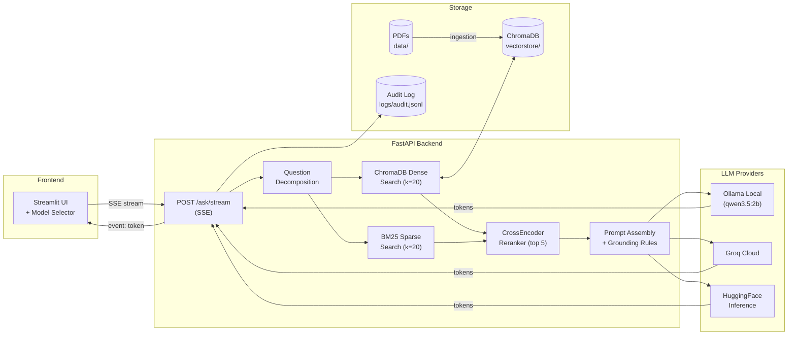

# Capstone Project — Completion Plan

> **Status:** File tasks mostly complete; runtime verification pending  
> **Last Updated:** 2026-10-10  
> **Instructions:** Each task below is self-contained. Work through them in order. Do NOT modify `app/rag.py` retrieval/chunking/reranking logic — it is stable and working.

---

## Phase 1: Stabilize The App

### Task 1.1 — Fix audit latency timer in `app/main.py`
- **File:** `app/main.py`
- **Problem:** `started = time.perf_counter()` is placed BEFORE the fake status sleeps (3.5s total), so `latency_ms` in the audit log includes artificial delay.
- **Fix:** Move `started = time.perf_counter()` to just before the `run_in_threadpool(prepare_answer, ...)` call, after all the `yield _status(...)` lines.
- [x] Done

### Task 1.2 — Reduce fake status delays in `app/main.py`
- **File:** `app/main.py`
- **Current values:** 0.8s + 1.2s + 1.5s = 3.5s total
- **Change to:** 0.3s + 0.4s + 0.5s = 1.2s total
- [x] Done

### Task 1.3 — Verify backend starts cleanly
- **Command:** `uvicorn app.main:app --reload`
- **Expected:** "Application startup complete" with no ImportError or crash
- **Note:** pypdf offset warnings are harmless, ignore them
- [ ] Done

### Task 1.4 — Verify frontend streams answers
- **Command:** `streamlit run frontend/streamlit_app.py`
- **Test:** Ask "What is the EMI due date?" — confirm tokens appear one by one, not all at once
- [ ] Done

### Task 1.5 — Verify sources display correctly
- **Test:** After answer appears, click "View Sources" expander
- **Expected:** Each source shows: PDF filename, page number, clause/section label, text excerpt
- [ ] Done

### Task 1.6 — Verify audit log writes
- **File to check:** `logs/audit.jsonl`
- **Test:** Ask 2 questions, then open the file
- **Expected:** 2 JSONL entries, each with `request_id`, `session_id`, `status`, `latency_ms`, `sources`
- [ ] Done

---

## Phase 2: Finalize Retrieval Quality

### Task 2.1 — Create test questions file
- **File to create:** `eval/test_questions.md`
- **Content:** A markdown table with 10 questions, expected answers, and expected source pages:

```markdown
| # | Question | Expected Answer (key phrase) | Expected Source |
|---|---|---|---|
| 1 | What is the foreclosure/prepayment charge? | Look for specific percentage or "as per sanction letter" | MBBL PDF |
| 2 | On what date is the EMI due each month? | "11th of every month" | MBBL PDF, page with schedule |
| 3 | Can a borrower dispute EMI calculation and withhold payment? | "No, obligation is absolute and unconditional" (Clause 3.9) | MBBL PDF, page 4 |
| 4 | What happens if a borrower stops payment on a cheque/PDC? | "Event of Default" (Clause 9.1) | MBBL PDF |
| 5 | Can the bank transfer or assign the loan to a third party? | "Yes, rights and obligations including interest rate, repricing" | Both PDFs |
| 6 | How long can a borrower travel abroad for a short visit? | "60 days" | MBBL PDF |
| 7 | What are the borrower's obligations regarding insurance? | Look for insurance maintenance clause | MBBL PDF |
| 8 | Under what conditions can the bank recall the loan immediately? | Event of Default conditions from Clause 9 | MBBL PDF |
| 9 | What is the exact rate of interest on the loan? | "The policy does not specify that" or template field | Correct — it's a blank template |
| 10 | Can I get a home loan? | Out-of-scope response about loan eligibility only | No policy source needed |
```

- [x] Done

### Task 2.2 — Run all 10 questions manually
- **How:** Ask each question in the Streamlit UI using the best provider (Groq recommended for speed)
- **Record:** For each question, note: actual answer, correct/wrong, sources shown, sources relevant yes/no
- [ ] Done

### Task 2.3 — Document results and limitations
- **File to update:** `eval/test_questions.md` (add a "Result" and "Notes" column)
- **Also add to `README.md`:** A "Known Limitations" section listing any questions that don't work perfectly, with honest explanation
- Suggested limitations to mention:
  - Letter-based sub-clauses (`p)`, `q)`, `r)`) in Jana PDF may show truncated section headers in citations
  - Clauses spanning page boundaries may be split into separate chunks
  - Answer quality depends on LLM capability (2B local model vs 20B+ cloud)
- [x] Done

---

## Phase 3: Add Evaluation Set + Promptfoo

### Task 3.1 — Create eval directory structure
```
eval/
├── test_questions.md      (from Phase 2)
├── questions.yaml          (Promptfoo test cases)
└── README.md              (how to run evaluations)
```
- [x] Done

### Task 3.2 — Create `eval/questions.yaml`
- **File to create:** `eval/questions.yaml`
- **Content:**
```yaml
tests:
  - description: "EMI dispute withholding"
    vars:
      question: "Can a borrower dispute EMI calculation and withhold EMI?"
    assert:
      - type: contains
        value: "absolute and unconditional"
      - type: not-contains
        value: "does not specify"

  - description: "EMI due date"
    vars:
      question: "On what date is the EMI due each month?"
    assert:
      - type: contains
        value: "11th"
      - type: not-contains
        value: "does not specify"

  - description: "Stop payment Event of Default"
    vars:
      question: "What happens if a borrower stops payment on a cheque provided for the loan?"
    assert:
      - type: contains
        value: "Event of Default"

  - description: "Loan assignment to third party"
    vars:
      question: "Can the bank transfer the loan to a third party?"
    assert:
      - type: icontains
        value: "transfer"
      - type: icontains
        value: "assign"

  - description: "Short visit abroad duration"
    vars:
      question: "How long can a borrower travel abroad for a short visit?"
    assert:
      - type: contains
        value: "60"

  - description: "Out of scope question"
    vars:
      question: "Can I get a home loan?"
    assert:
      - type: not-contains
        value: "home loan"

  - description: "Interest rate (blank template)"
    vars:
      question: "What is the exact rate of interest on the loan?"
    assert:
      - type: contains
        value: "does not specify"

  - description: "Foreclosure charge"
    vars:
      question: "What is the foreclosure or prepayment charge?"
    assert:
      - type: not-contains
        value: "does not specify"
```
- [x] Done

### Task 3.3 — Create `promptfooconfig.yaml`
- **File to create:** `promptfooconfig.yaml` (in project root)
- **Content:**
```yaml
description: "LoanBot RAG Quality Gate"

providers:
  - id: "http"
    config:
      url: "http://localhost:8000/ask"
      method: POST
      headers:
        Content-Type: application/json
      body:
        question: "{{question}}"
        history: []
        session_id: "eval-session"
        model_provider: "local"
      responseParser: "json.answer"

tests: file://eval/questions.yaml
```
- [x] Done

### Task 3.4 — Test Promptfoo locally
- **Prerequisites:** Backend must be running (`uvicorn app.main:app`)
- **Command:** `npx promptfoo eval`
- **Expected:** Table showing pass/fail for each test case
- **If promptfoo not installed:** `npm install -g promptfoo` or use `npx`
- [ ] Done

### Task 3.5 — Create GitHub Actions workflow
- **File to create:** `.github/workflows/eval.yml`
- **Content:**
```yaml
name: RAG Quality Gate

on:
  push:
    branches: [main]
  pull_request:
    branches: [main]

jobs:
  evaluate:
    runs-on: ubuntu-latest
    steps:
      - uses: actions/checkout@v4

      - name: Set up Python
        uses: actions/setup-python@v5
        with:
          python-version: "3.11"

      - name: Install dependencies
        run: pip install -r requirements.txt

      - name: Start backend
        env:
          GROQ_API_KEY: ${{ secrets.GROQ_API_KEY }}
          GROQ_MODEL: "llama3-8b-8192"
          FALLBACK_MODEL_PROVIDER: "groq"
        run: |
          uvicorn app.main:app --host 0.0.0.0 --port 8000 &
          sleep 15

      - name: Run Promptfoo evaluation
        run: npx promptfoo@latest eval --no-cache

      - name: Check results
        run: npx promptfoo@latest eval --no-cache --output results.json
```
- **Note:** This uses Groq in CI (no Ollama needed). Add `GROQ_API_KEY` as a GitHub repository secret.
- [x] Done

### Task 3.6 — Create `eval/README.md`
- **Content:** Brief instructions on how to run evaluations locally and what the CI gate does
- [x] Done

---

## Phase 4: Audit + Observability Demo

### Task 4.1 — Generate audit log entries
- **How:** Ask 5 different questions via the Streamlit UI
- **Check:** Open `logs/audit.jsonl` and confirm entries exist
- [ ] Done

### Task 4.2 — Check what gets logged
- **File to review:** `app/audit.py` (the `write_audit_event` function)
- **Verify these fields are present:** `request_id`, `session_id`, `timestamp`, `status`, `latency_ms`, `sources`
- **Check if `question` text is logged:** If yes, decide whether to keep it (useful for debugging) or remove it (privacy). Document the decision in README.
- [x] Done

### Task 4.3 — Verify Langfuse traces
- **Check:** If `LANGFUSE_SECRET_KEY` and `LANGFUSE_PUBLIC_KEY` are set in `.env`, open the Langfuse dashboard and confirm traces appear
- **If Langfuse is not configured:** Note in README: "Langfuse integration is included but requires API keys. Set LANGFUSE_SECRET_KEY and LANGFUSE_PUBLIC_KEY in .env to enable."
- [ ] Done

### Task 4.4 — Prepare observability summary
- **For demo slides / README, document what gets tracked:**
  - Request ID (unique per question)
  - Session ID (groups a conversation)
  - Latency in milliseconds
  - Status (completed / failed)
  - Source pages used in the answer
  - Provider requested vs provider used
  - Langfuse trace (if enabled)
- [x] Done

---

## Phase 5: Docker Finalization

### Task 5.1 — Decide demo mode
- **Recommended:** Local Python + Ollama (simplest, fastest, best quality)
- **Alternative:** Docker frontend/backend + host Ollama
- **Document the decision in README**
- [x] Done

### Task 5.2 — Fix `requirements-docker.txt`
- **File:** `requirements-docker.txt`
- **Add these missing packages:**
```
nltk
sentence-transformers
```
- **Or:** Make CrossEncoder optional in `app/rag.py`:
```python
try:
    from sentence_transformers import CrossEncoder
    _CROSS_ENCODER_AVAILABLE = True
except ImportError:
    _CROSS_ENCODER_AVAILABLE = False
    logger.warning("sentence-transformers not installed; CrossEncoder reranking disabled.")
```
Then in `_get_reranker()` and `_rerank_candidates()`, check `_CROSS_ENCODER_AVAILABLE` before using it.
- [x] Done

### Task 5.3 — Fix Dockerfile for NLTK data
- **File:** `Dockerfile`
- **Add after the pip install line:**
```dockerfile
RUN python -c "import nltk; nltk.download('punkt_tab')"
```
- [x] Done

### Task 5.4 — Test Docker build and run
- **Commands:**
```bash
docker-compose build
docker-compose up
```
- **Verify:** Backend starts, frontend loads at `http://localhost:8501`, answers stream
- **If Docker is not part of demo:** Just confirm `docker-compose build` succeeds without errors
- [ ] Done

---

## Phase 6: Documentation

### Task 6.1 — Update `README.md` with complete sections
- **File:** `README.md`
- **Ensure these sections exist and are accurate:**

1. **Project Overview** — What LoanBot does, business problem it solves
2. **Architecture** — Mermaid diagram (see Phase 7) + brief text explanation
3. **Tech Stack** — Table of all technologies used
4. **Project Structure** — Tree of important files with 1-line descriptions
5. **Local Setup** — Step-by-step:
   ```
   1. Clone repo
   2. Create virtual environment: python -m venv capstone
   3. Activate: capstone\Scripts\activate (Windows) or source capstone/bin/activate (Linux/Mac)
   4. Install: pip install -r requirements.txt
   5. Pull models: ollama pull nomic-embed-text && ollama pull qwen3.5:2b
   6. Copy .env: cp .env.example .env (edit API keys if using Groq/HF)
   7. Start backend: uvicorn app.main:app --reload
   8. Start frontend: streamlit run frontend/streamlit_app.py
   ```
6. **Docker Setup** — `docker-compose up --build` or note "local recommended"
7. **Environment Variables** — Table:
   ```
   | Variable | Default | Description |
   |---|---|---|
   | CHAT_MODEL | qwen3.5:2b | Ollama model for answer generation |
   | EMBEDDING_MODEL | nomic-embed-text | Ollama model for embeddings |
   | OLLAMA_BASE_URL | http://localhost:11434 | Ollama server URL |
   | GROQ_API_KEY | (empty) | Groq cloud API key |
   | GROQ_MODEL | (set in .env) | Model name on Groq |
   | HF_API_KEY | (empty) | HuggingFace API key |
   | HF_MODEL | mistralai/Mistral-7B-Instruct-v0.3 | Model on HuggingFace |
   | FORCE_REBUILD_VECTORSTORE | false | Set to true to re-ingest PDFs |
   | FALLBACK_MODEL_PROVIDER | none | Auto-fallback: groq, hf, or none |
   ```
8. **Sample Questions** — 5 example questions with expected behavior
9. **Evaluation** — How to run `promptfoo eval`
10. **Known Limitations** — Honest list:
    - Letter-based sub-clauses (p, q, r) in Jana PDF may show truncated citation headers
    - Clauses spanning page boundaries may be split
    - Local 2B model gives shorter/less detailed answers than Groq 20B
    - HuggingFace free tier may refuse large models (27B+)

- [x] Done

### Task 6.2 — Update `project_architecture_summary.md`
- **File:** `project_architecture_summary.md`
- **Content:** Plain-English, file-by-file explanation:
  - `app/rag.py` — Core RAG pipeline: PDF loading, NLTK sentence chunking, ChromaDB + BM25 hybrid retrieval, CrossEncoder reranking, prompt assembly, multi-provider LLM calling
  - `app/main.py` — FastAPI server with SSE streaming, fake status wrapper, audit logging
  - `app/config.py` — Environment variable loading with defaults
  - `app/tracing.py` — Langfuse integration and audit JSONL writer
  - `frontend/streamlit_app.py` — Streamlit chat UI with model selector, SSE consumer, source display
  - `data/` — Policy PDF files (2 loan agreements)
  - `vectorstore/` — ChromaDB persistent storage + documents_cache.json
  - `logs/` — Audit JSONL log
  - `eval/` — Test questions and Promptfoo config
- [x] Done

### Task 6.3 — Update `checklist.md`
- **File:** `checklist.md`
- **Mark completed items, add any new items from this plan**
- [x] Done

---

## Phase 7: Architecture Diagram

### Task 7.1 — Add Mermaid diagram to README
- **File:** `README.md` (in the Architecture section)
- **Diagram:**

````markdown

````
- [x] Done

---

## Summary: Priority Order

| Priority | Phase | Estimated Time |
|---|---|---|
| 🔴 Do First | Phase 1: Stabilize App | 30 min |
| 🔴 Do First | Phase 2: Retrieval Quality Testing | 1 hour |
| 🔴 Do First | Phase 6: Documentation | 1 hour |
| 🟡 Do Next | Phase 3: Promptfoo + CI Gate | 2 hours |
| 🟡 Do Next | Phase 4: Audit Demo Prep | 30 min |
| 🟡 Do Next | Phase 7: Architecture Diagram | 20 min |
| 🟢 If Time | Phase 5: Docker Fixes | 45 min |
